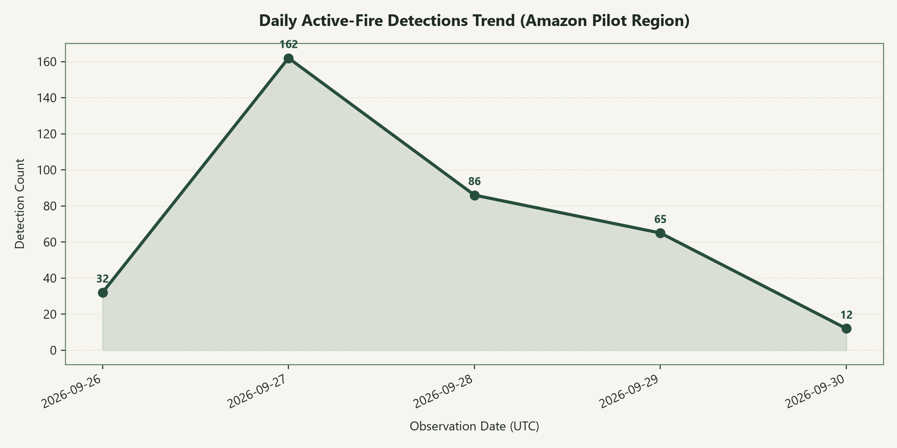
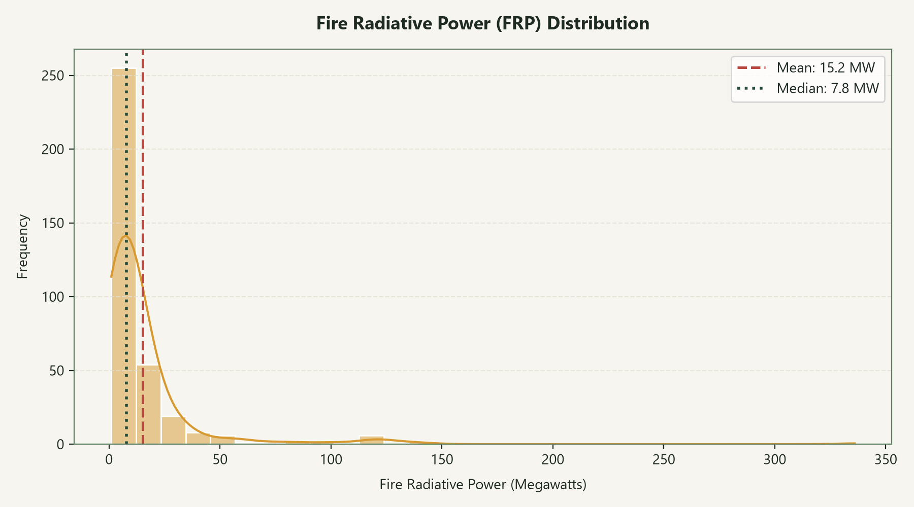
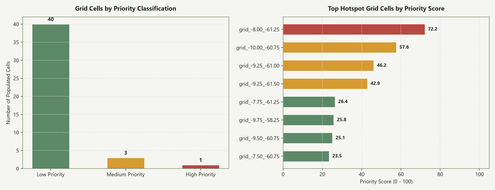
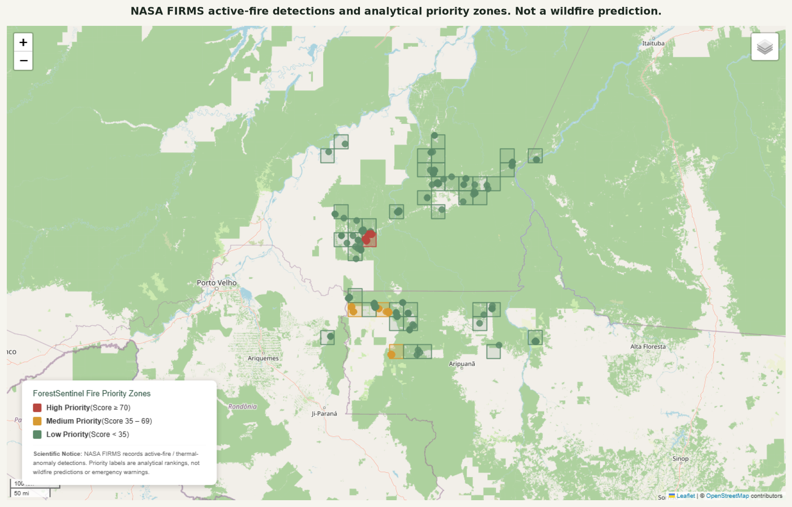
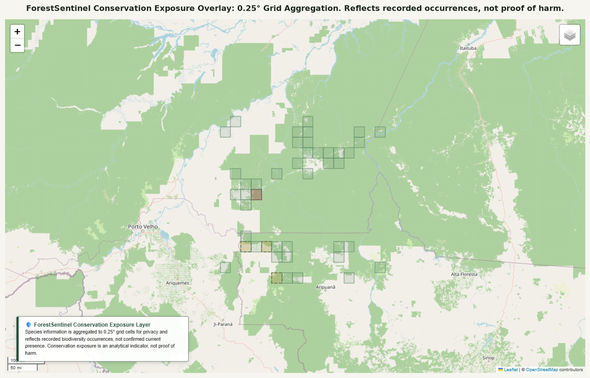
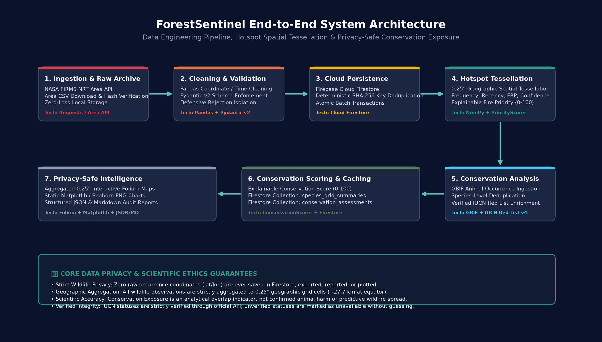
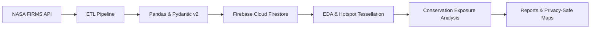

# ForestSentinel

> A data-engineering and geospatial analytics platform that transforms NASA satellite fire detections into explainable fire-activity and conservation-exposure insights.

ForestSentinel is an end-to-end data pipeline and geospatial intelligence system designed for the Amazon Basin. It ingests near-real-time active-fire thermal anomalies from NASA FIRMS, validates data integrity using Pydantic v2 schemas, stores deduplicated records in Google Cloud Firestore, performs 0.25° spatial grid tessellation with explainable priority scoring, and integrates biodiversity occurrence records from GBIF with IUCN Red List conservation categories under strict wildlife privacy safeguards.

---

## Project Status Badges


---

## Key Outcomes & Verified Metrics

All metrics below reflect real, verified executions against live services (NASA FIRMS, Cloud Firestore, and GBIF):

| Metric | Verified Live Result | Notes / Verification Source |
|---|---:|---|
| NASA FIRMS detections ingested | **357** | Real NRT satellite observations (VIIRS NOAA-21) |
| Data validation pass rate | **100%** | 357 records passed strict Pydantic v2 schema |
| Duplicate prevention on rerun | **357 skipped** | Deterministic SHA-256 detection key prevents duplicate writes |
| Populated 0.25° grid cells analyzed | **44** | Amazon pilot bounding box `[-62, -10, -58, -6]` |
| High-priority fire activity cells | **1** | Cell `grid_-8.00_-61.25` (Score: 72.2 / 100) |
| Medium-priority fire activity cells | **3** | Cells `grid_-10.00_-60.75`, `grid_-9.25_-61.00`, `grid_-9.25_-61.50` |
| Low-priority fire activity cells | **40** | Lower relative detection volume and limited recent activity |
| Medium/High cells queried for biodiversity | **4** | Focused query approach keeping API calls manageable |
| GBIF animal occurrence records received | **31** | In-memory normalized; non-animal records excluded |
| Unique animal species identified | **23** | Deduplicated by taxon key & normalized scientific name |
| Species with verified IUCN status | **0** | `IUCN_API_TOKEN` unconfigured; honestly reported as unavailable |
| Species falsely classified as threatened | **0** | Zero guessing; unverified statuses remain unranked |
| Aggregated species-grid records in Firestore | **23** | Saved to collection `species_grid_summaries` |
| Exact wildlife coordinates stored or mapped | **0** | Strict privacy rule enforced via schema sanitization |
| Automated unit & integration tests | **68 passing** | 100% offline; execution time ~11s across Parts 1, 2, and 3 |

---

## Visual Evidence & Proof of Work

### 1. Temporal Detection Dynamics

*Daily distribution of 357 active-fire detections across the observation window, illustrating peak thermal-anomaly concentration and temporal progression.*

---

### 2. Combustion Intensity & Priority Classification
| Fire Radiative Power (MW) Distribution | Hotspot Grid Cell Priority Distribution |
|---|---|
|  |  |
| *Log-scaled Fire Radiative Power (MW) distribution highlighting median combustion intensity alongside high-intensity outliers.* | *Distribution of 44 populated 0.25° grid cells across Low (40), Medium (3), and High (1) Fire Activity Priority classes.* |

---

### 3. Geospatial Hotspot Map Preview

*Interactive Folium map preview displaying 0.25° tessellated grid cells color-coded by Fire Activity Priority Score with detection overlays. (NASA FIRMS active-fire detections and analytical priority zones. Not a wildfire prediction).*

---

### 4. Conservation Exposure Overlay Preview

*Geospatial overlay of Medium and High fire-priority zones enriched with aggregated GBIF species occurrence counts. (ForestSentinel Conservation Exposure Overlay: 0.25° Grid Aggregation. Reflects recorded occurrences, not proof of harm).*

---

## The Problem

Environmental satellite data and ecological biodiversity records are historically siloed:
- **Raw satellite telemetry is hard to interpret:** Satellite active-fire observations (such as NASA FIRMS VIIRS/MODIS) provide raw point detections with sensor-specific fields (FRP, brightness temperature, confidence) that do not directly translate into operational priority.
- **Wildlife exposure is unquantified:** Biodiversity occurrence data from global repositories (such as GBIF) are detached from real-time disturbance telemetry, leaving conservationists without a unified view of potential habitat exposure.
- **Poaching & disturbance risks:** Publishing exact locations of threatened animal species creates critical wildlife security risks.

---

## The Solution

ForestSentinel bridges the gap between satellite remote sensing and biodiversity data through an ethical, explainable data-engineering platform:
- **Robust Pipeline:** Validates and cleans raw NASA FIRMS satellite observations and archives raw source data.
- **Cloud Deduplication:** Stores detections in Google Cloud Firestore using deterministic SHA-256 keys to prevent duplicate records.
- **Spatial Tessellation:** Divides the study region into 0.25° (~27.7 km) grid cells, aggregating frequency, recency, intensity (FRP), and confidence into an explainable **Fire Activity Priority Score (0–100)**.
- **Privacy-Safe Conservation Intelligence:** Queries GBIF occurrences for elevated fire-activity cells, filters strictly for animal species, cross-references conservation statuses via the official IUCN Red List API v4, and scores potential exposure without ever storing or displaying point coordinates.
- **Honest Scientific Guardrails:** The platform provides analytical decision support and never claims to predict wildfires, confirm animal mortality, or replace official emergency guidance.

---

## System Architecture





---

## Features by Phase

| Phase | Status | Capabilities |
|---|---|---|
| **Part 1 — Active-Fire ETL Pipeline** | **Complete** | NASA FIRMS NRT extraction, local CSV archive, Pandas cleaning, Pydantic v2 validation, Firestore persistence (`fire_detections`, `rejected_records`, `etl_runs`), deterministic SHA-256 deduplication. |
| **Part 2 — Fire Activity Intelligence** | **Complete** | Exploratory Data Analysis, FRP combustion metrics, temporal hour/day analysis, 0.25° geographic grid tessellation, explainable Fire Activity Priority Score (0–100), static charts, interactive Folium HTML map. |
| **Part 3 — Conservation Exposure Analysis** | **Complete** *(IUCN token optional)* | GBIF animal occurrence ingestion, species deduplication by taxon key, IUCN Red List v4 enrichment, explainable Conservation Exposure Score (0–100), Firestore collections (`species_grid_summaries`, `conservation_analysis_runs`, `conservation_assessments`), privacy-safe map overlay. |

---

## Fire Activity Priority Score (Part 2)

The Fire Activity Priority Score evaluates satellite fire activity across four transparent, explainable dimensions:

$$\text{Priority Score} = \left( 0.45 \cdot \hat{F} + 0.25 \cdot \hat{R} + 0.20 \cdot \hat{I} + 0.10 \cdot \hat{C} \right) \times 100$$

| Component | Weight | Analytical Meaning |
|---|---:|---|
| **Detection Frequency ($\hat{F}$)** | **45%** | Min-max normalized total active-fire detections in the grid cell |
| **Recent Activity ($\hat{R}$)** | **25%** | Detections recorded within the final 48 hours of the observation window |
| **Mean Intensity / FRP ($\hat{I}$)** | **20%** | Average Fire Radiative Power (MW) measuring combustion energy |
| **Confidence Factor ($\hat{C}$)** | **10%** | Proportion of detections flagged as high or nominal confidence |

**Dynamic Weight Redistribution:**
If FRP or confidence telemetry is absent in an ingested source, the scorer automatically redistributes the unallocated weight proportionally across the remaining available metrics, ensuring numerical stability without division by zero.

**Classification Thresholds:**
- **High Priority:** Score $\ge 70.0$
- **Medium Priority:** Score $35.0 - 69.9$
- **Low Priority:** Score $< 35.0$

> **SCIENTIFIC NOTICE:**  
> This is a retrospective analytical ranking based on recorded NASA FIRMS thermal anomalies, not a wildfire-prediction model or official emergency evacuation warning.

---

## Conservation Exposure Priority Score (Part 3)

The Conservation Exposure Priority Score evaluates potential conservation monitoring priorities where elevated fire activity coincides with recorded historical occurrences of threatened wildlife:

$$\text{Conservation Exposure Score} = \left( 0.45 \cdot \hat{S}_{\text{fire}} + 0.35 \cdot W_{\text{IUCN}} + 0.20 \cdot \hat{O}_{\text{occ}} \right) \times 100$$

| Component | Weight | Meaning |
|---|---:|---|
| **Fire Activity Priority ($\hat{S}_{\text{fire}}$)** | **45%** | Normalized Part 2 fire score for the cell ($\text{Score} / 100.0$) |
| **IUCN Threat Severity ($W_{\text{IUCN}}$)** | **35%** | Critically Endangered ($\text{CR}=1.00$), Endangered ($\text{EN}=0.75$), Vulnerable ($\text{VU}=0.50$) |
| **Occurrence Evidence ($\hat{O}_{\text{occ}}$)** | **20%** | Normalized count of recorded GBIF occurrences in the cell |

**Scientific & Ethical Constraints:**
- **Scored Only When Verified:** Only species with an authenticated IUCN API category of CR, EN, or VU receive an exposure score.
- **Strict Tri-State Conservation Classification:**
  1. `Pending IUCN Verification`: Used when `iucn_verified=False` or `iucn_category` is missing. No conservation exposure score is calculated, and the species is not classified as threatened or not threatened.
  2. `Verified Not Threatened`: Used only when IUCN verification succeeds and the returned category is not CR, EN, or VU (e.g. LC, NT, DD).
  3. `Verified Threatened`: Used only when IUCN verification succeeds and the category is CR, EN, or VU.
- **Current Run Status:** No threatened-species classifications are available in this run because IUCN verification has not yet been configured. All 23 species-grid summaries are labeled `Pending IUCN Verification`.
- **Zero Coordinates:** All wildlife data is strictly aggregated to 0.25° grid cells. Exact observation coordinates are never saved in Firestore, exported, reported, or mapped.
- **Potential Exposure, Not Harm:** This metric reflects potential spatial overlap, not confirmed animal injury or mortality.

---

## Technology Stack

| Domain | Technology / Library | Role in ForestSentinel |
|---|---|---|
| **Satellite Fire Data** | NASA FIRMS NRT Area API | Near-real-time VIIRS/MODIS thermal anomaly ingestion |
| **Data Engineering** | Python 3.10+, Requests, Pandas | Data extraction, CSV archiving, cleaning, coordinate validation |
| **Data Validation** | Pydantic v2 | Strict schema validation, isolation of rejected records |
| **Cloud Database** | Firebase Cloud Firestore | Document database with batch operations and deterministic keys |
| **Statistical Analysis** | NumPy, SciPy | Min-max normalization, temporal binning, weight redistribution |
| **Static Visualizations** | Matplotlib, Seaborn | High-resolution publication-quality PNG charts |
| **Geospatial Mapping** | Folium (Leaflet.js) | Interactive HTML maps with 0.25° grid overlays and popup details |
| **Biodiversity Data** | GBIF Occurrence Search API | In-memory animal occurrence retrieval by grid bounding box |
| **Conservation Status** | IUCN Red List API v4 | Optional authenticated species category verification |
| **Automated Testing** | Pytest, unittest.mock | 68 offline unit and integration tests (zero network dependency) |

---

## Repository Structure

```text
ForestSentinel/
├── .env.example                     # Environment template (FIRMS, Firebase, GBIF, IUCN)
├── .gitignore                       # Git ignore rules protecting credentials, raw data & reports
├── pytest.ini                       # Pytest test discovery configuration
├── requirements.txt                 # Pinned project dependencies
├── README.md                        # Project documentation and visual proof
├── run_pipeline.py                  # Part 1: NASA FIRMS ETL pipeline runner
├── run_analysis.py                  # Part 2: Fire Activity EDA & hotspot scoring runner
├── run_conservation_analysis.py     # Part 3: Conservation exposure analysis runner
├── docs/
│   └── assets/                      # Git-tracked visual proof assets and architecture diagram
│       ├── architecture.png
│       ├── daily_fire_activity.png
│       ├── frp_distribution.png
│       ├── hotspot_priority_distribution.png
│       ├── fire_activity_map_preview.png
│       └── conservation_exposure_preview.png
├── src/
│   └── forestsentinel/              # Core application package
│       ├── __init__.py              # Package entry and versioning (0.3.0)
│       ├── config.py                # Typed immutable configuration and validation
│       ├── extractor.py             # NASA FIRMS API extraction and CSV archive
│       ├── transformer.py           # Pandas cleaning, coordinate clipping, key generation
│       ├── schemas.py               # Pydantic v2 FireDetection schema
│       ├── firebase_client.py       # Firestore client wrapper and batch operations
│       ├── pipeline.py              # Part 1 ETL orchestration and logging setup
│       ├── reporter.py              # Part 1 ETL audit report generator
│       ├── analyzer.py              # Part 2 FireActivityAnalyzer (temporal, intensity, EDA)
│       ├── analytics_repository.py  # Part 2 Firestore read-only data access layer
│       ├── priority_scoring.py      # Part 2 PriorityScorer (0.25° grid, explainable scoring)
│       ├── visualizer.py            # Part 2 Matplotlib charts and Folium map generator
│       ├── analysis_reporter.py     # Part 2 JSON & Markdown report generator
│       ├── gbif_client.py           # Part 3 GBIF Occurrence API client
│       ├── iucn_client.py           # Part 3 IUCN Red List API v4 client and cache
│       ├── conservation_scoring.py  # Part 3 ConservationScorer (0-100 explainable score)
│       ├── conservation_analyzer.py # Part 3 ConservationAnalyzer (deduplication, enrichment)
│       ├── conservation_repository.py # Part 3 Firestore repository (privacy-enforced)
│       ├── conservation_visualizer.py # Part 3 ConservationVisualizer (charts & Folium map)
│       ├── conservation_reporter.py # Part 3 JSON & Markdown audit report generator
│       └── conservation_pipeline.py # Part 3 ConservationPipeline orchestration
└── tests/                           # 68 offline unit and integration tests
    ├── test_config.py
    ├── test_extractor.py
    ├── test_transformer.py
    ├── test_schemas.py
    ├── test_firebase_client.py
    ├── test_reporter.py
    ├── test_analyzer.py
    ├── test_analytics_repository.py
    ├── test_priority_scoring.py
    ├── test_visualizer.py
    ├── test_gbif_client.py
    ├── test_iucn_client.py
    ├── test_conservation_scoring.py
    ├── test_conservation_analyzer.py
    └── test_conservation_reporter.py
```

---

## Local Setup & Installation

### 1. Clone Repository & Create Virtual Environment

```bash
git clone <your-repository-url>
cd ForestSentinel
python -m venv .venv
```

**Activate Virtual Environment:**
- **Windows (PowerShell):**
  ```powershell
  .venv\Scripts\Activate.ps1
  ```
- **macOS / Linux:**
  ```bash
  source .venv/bin/activate
  ```

### 2. Install Dependencies

```bash
pip install -r requirements.txt
```

### 3. Configure Environment Variables

Copy `.env.example` to `.env`:

```bash
cp .env.example .env
```

Configure your credentials in `.env`:

```env
# NASA FIRMS API (Get free key: https://firms.modaps.eosdis.nasa.gov/api/map_key)
NASA_FIRMS_MAP_KEY=your_nasa_firms_map_key_here
FIRMS_SOURCE=VIIRS_NOAA21_NRT
AMAZON_BBOX=-62,-10,-58,-6
DAY_RANGE=5

# Firebase Cloud Firestore
FIREBASE_SERVICE_ACCOUNT_PATH=secrets/firebase-service-account.json
FIREBASE_PROJECT_ID=your_firebase_project_id_here

# Grid Resolution & Logging
GRID_SIZE_DEGREES=0.25
LOG_LEVEL=INFO

# Part 3: GBIF & IUCN Red List API v4
GBIF_MAX_RECORDS_PER_GRID=300
GBIF_REQUEST_TIMEOUT_SECONDS=30
IUCN_API_TOKEN=optional_iucn_token_here
IUCN_API_BASE_URL=https://api.iucnredlist.org
```

> **Security Note:** `.env` and `secrets/*.json` are explicitly ignored by `.git`. Never commit API keys or service account credentials.

---

## Pipeline Execution Commands

### Part 1: Extract, Validate & Ingest Active-Fire Detections
Ingests real NASA FIRMS active fires, archives raw CSV, validates via Pydantic v2, and saves deduplicated records into Firestore:
```bash
python run_pipeline.py
```

### Part 2: Fire Activity EDA, Hotspot Tessellation & Priority Scoring
Loads validated records from Firestore, computes intensity/temporal metrics, generates static charts, an interactive Folium map, and comprehensive audit reports:
```bash
python run_analysis.py
```

### Part 3: Conservation Exposure Analysis
Recomputes priority zones, queries GBIF occurrences for Medium and High fire-activity cells, enriches with IUCN categories (where configured), computes Conservation Exposure scores, persists aggregated summaries to Firestore, and produces privacy-safe maps and reports:
```bash
python run_conservation_analysis.py
```

### Run Full Test Suite
Executes all 68 offline unit and integration tests:
```bash
python -m pytest -v
```

---

## Data Responsibility & Scientific Limitations

To maintain the highest standards of scientific and ethical integrity, ForestSentinel adheres strictly to these principles:

1. **Thermal Anomalies vs. Confirmed Wildfires:** NASA FIRMS records active thermal anomalies detected by satellite sensors (VIIRS/MODIS). An anomaly indicates a thermal emission signal; it does not automatically differentiate between controlled agricultural burning, industrial flaring, or uncontrolled wildfires without ground verification.
2. **Short Observation Windows:** Data from near-real-time (NRT) overpasses represent operational snapshots (typically 1 to 5 days) and cannot establish long-term climatic or deforestation trends.
3. **Not a Wildfire Prediction Model:** The Fire Activity Priority Score is a retrospective analytical ranking of observed satellite detections. It does **not** predict fire propagation, wind-driven spread, or future ignition risks.
4. **GBIF Records Indicate Past Occurrence, Not Current Presence:** GBIF records reflect historical biodiversity observations from research collections, citizen science, and surveys. A record demonstrates documented historical occurrence, not guaranteed current occupancy.
5. **Verified IUCN Conservation Statuses Only:** IUCN Red List categories are displayed only when verified through the configured official IUCN API v4. ForestSentinel never guesses or scrapes unverified statuses.
6. **Wildlife Privacy Enforcement:** To protect endangered species from poaching and illegal trafficking, point coordinates are strictly excluded from all Firestore collections, markdown reports, logs, and map popups. Wildlife data is aggregated solely to 0.25° grid cells.
7. **Educational & Analytical Scope:** ForestSentinel is an educational, research-oriented decision-support tool. It does **not** provide official emergency, disaster-response, or evacuation guidance.

---

## Testing & Verification

The project includes an automated test suite executed via pytest:

```bash
python -m pytest -v
```

**Results:**
- **68 passed tests** in **~11.3 seconds**
- **Zero failures, zero warnings, 100% offline execution**
- Mocked HTTP requests and in-memory Firestore fixtures prevent accidental external API calls during testing.

**Verified Live System Components:**
- NASA FIRMS API extraction and raw CSV archive (`data/raw/`)
- Cloud Firestore connection (`forestsentinel-58520`) with atomic batch writes
- SHA-256 deterministic key deduplication (skipping 357 duplicates on rerun)
- Part 2 EDA metrics, 44 grid cells tessellated, static PNG charts, Folium HTML map
- Part 3 live GBIF querying (31 occurrences received, 23 unique animal species)
- Honest fallback when `IUCN_API_TOKEN` is unconfigured (0 false threatened species)
- Firestore persistence of `species_grid_summaries` with zero point coordinates

---

## Future Roadmap

The following capabilities represent intentional extensions planned for future phases:

- [ ] Integrate real-time weather data (ERA5 / Open-Meteo wind speed, relative humidity, temperature)
- [ ] Incorporate satellite fuel-moisture and vegetation indices (NDVI / NDWI)
- [ ] Train and evaluate an explainable machine learning fire-risk model
- [ ] Ingest official Brazilian indigenous land and protected-area boundaries (FUNAI / ICMBio)
- [ ] Develop a secure, role-based interactive web dashboard (Next.js / FastAPI)
- [ ] Deploy scheduled automated ETL pipelines with cloud-native monitoring (Google Cloud Run / Cloud Functions)

---

## License & Acknowledgments

### License
*License to be added.* (All rights reserved for academic / project evaluation).

### Acknowledgments
- **NASA FIRMS**: Active fire data provided by LANCE / FIRMS operated by NASA ESDIS.
- **GBIF**: Global Biodiversity Information Facility Occurrence Search API for global biodiversity data.
- **IUCN**: International Union for Conservation of Nature Red List of Threatened Species.
- **Google Cloud Firebase**: Cloud Firestore NoSQL document database infrastructure.
- **Open-Source Python Ecosystem**: Built with Pandas, Pydantic, NumPy, Matplotlib, Seaborn, Folium, and Pytest.
